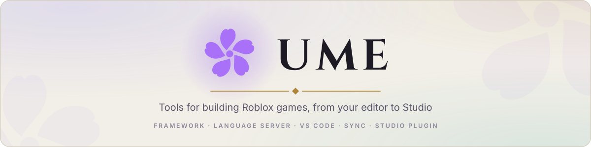
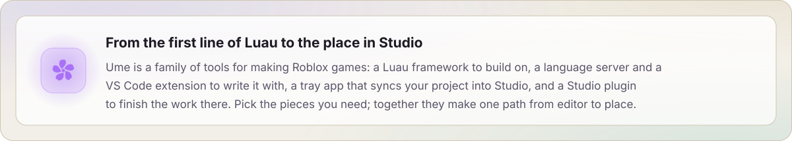
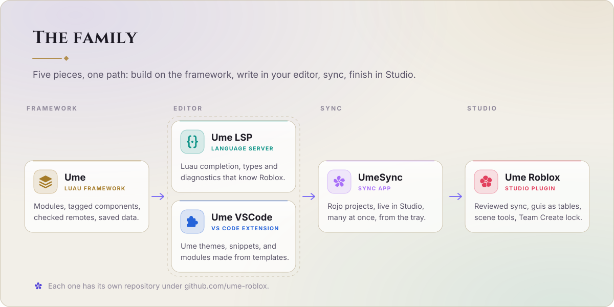
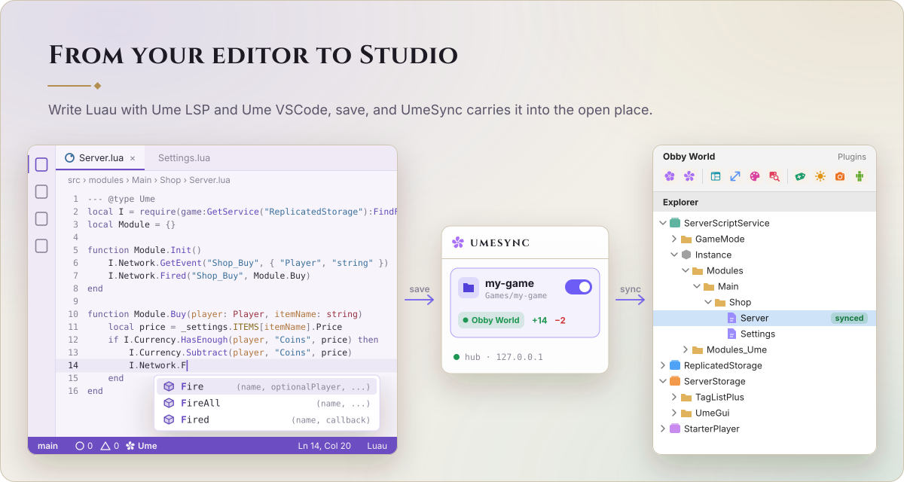
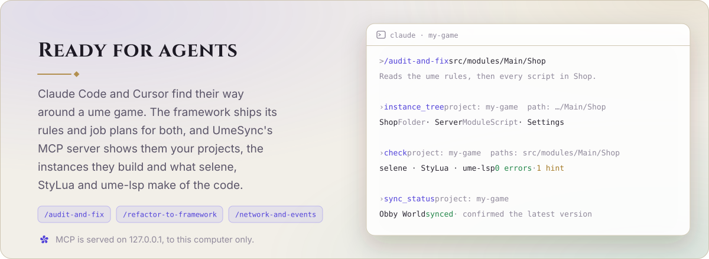

<picture>
  <source media="(prefers-color-scheme: dark)" srcset="docs/assets/banner-dark.svg">
  
</picture>

<picture>
  <source media="(prefers-color-scheme: dark)" srcset="docs/assets/intro-dark.svg">
  
</picture>

<picture>
  <source media="(prefers-color-scheme: dark)" srcset="docs/assets/family-dark.svg">
  
</picture>

<picture>
  <source media="(prefers-color-scheme: dark)" srcset="docs/assets/panel-workflow-dark.svg">
  
</picture>

<picture>
  <source media="(prefers-color-scheme: dark)" srcset="docs/assets/panel-agents-dark.svg">
  
</picture>

## The family

| | Repository | |
| --- | --- | --- |
| **Ume** | [ume](https://github.com/ume-roblox/ume) | A lightweight Luau framework for Roblox games: modules, tagged components, checked remotes and saved player data |
| **Ume Gui** | [ume-gui](https://github.com/ume-roblox/ume-gui) | UmeGui, guis as tables: a theme for every look, previews and exports in Studio, at every device size |
| **New Project** | [new-project](https://github.com/ume-roblox/new-project) | The template for a new game: one repo whose setup copies Ume and Ume Gui into `<game>-game` and `<game>-gui` |
| **Ume LSP** | [ume-lsp](https://github.com/ume-roblox/ume-lsp) | A Luau language server for VS Code: completion, types and diagnostics that know the Roblox API and your project's instance tree |
| **Ume VSCode** | [ume-vscode](https://github.com/ume-roblox/ume-vscode) | The Ume and Ume Light themes, Luau snippets, and commands that write modules, components and data files from templates |
| **UmeSync** | [ume-sync](https://github.com/ume-roblox/ume-sync) | A tray app that syncs project folders into Studio: Rojo-compatible, many projects into many Studios, with MCP for agents |
| **Ume Roblox** | [ume-rbx](https://github.com/ume-roblox/ume-rbx) | One Studio plugin: live sync with a review of every change, UmeGui, scene tools and a Team Create session lock |

## How it fits together

1. **Build on Ume.** Every module, component and data file has its place, and they all start in one order on the server
   and the client. A game starts from New Project, which puts the game's code and its guis (a copy of Ume Gui) side
   by side in one repo.
2. **Write in VS Code.** Ume LSP completes and checks your Luau as you type. Ume VSCode makes new modules, components
   and data files in the framework's layout.
3. **Sync with UmeSync.** Add the project folder once; it serves every project from one local hub.
4. **Finish in Studio.** Ume Roblox's Sync tool connects to the hub, shows what will change and keeps the place in step.
   Its other tools take care of guis, lighting, tags, pictures and avatars.

Most pieces work on their own too: the framework with any Rojo-compatible sync, Ume LSP in any Luau workspace, the plugin's gui and scene
tools without the app.

## Version badges

`src/` holds a [shields.io endpoint](https://shields.io/badges/endpoint-badge) file per repository with its current
version, for other READMEs to show:

```md

```

`framework.json`, `gui.json`, `lsp.json`, `vscode-extension.json`, `roblox-extension.json` and `sync.json`.

---

<div align="center">

**Ume is released under a custom [licence](LICENSE.md)**
<br>
Maintained with 😭 by <b>Nari</b>

</div>
